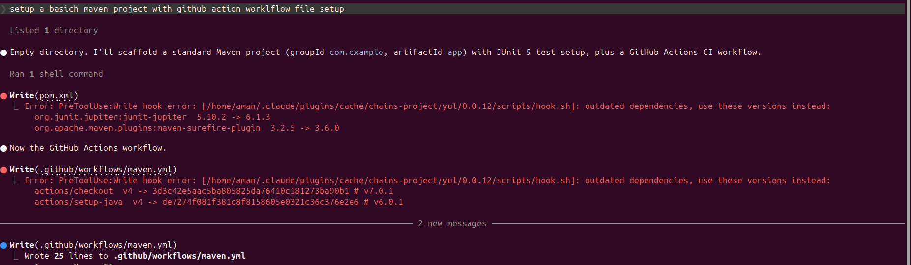
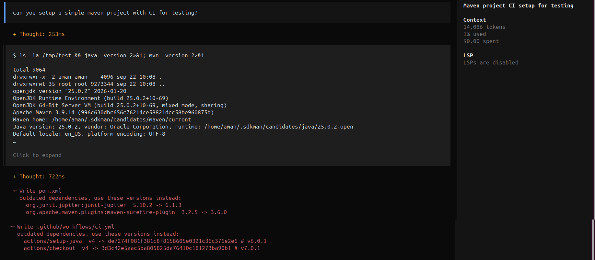
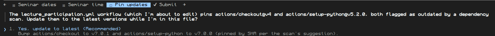

<p align="center">
  
  
</p>

Force your AI agents (Claude Code and OpenCode) to use the latest release of a dependency instead of the outdated version they remember from training data. When an agent writes a stale pin into a manifest, yul blocks the write and tells the agent the latest version, so it retries with that one.

## Results

Coding agents often write a dependency version from memory, and that version is usually outdated. For example, both agents we tested write `actions/checkout@v4` when the latest release was v7.0.1. yul blocks these writes and the agent retries with the latest release.

We ran the [benchmark](https://github.com/chains-project/yul-benchmark) tasks three times each without and with yul 0.0.21, on Claude Code with Claude Opus 5.5 and OpenCode with DeepSeek V4.1 Flash. yul helps most for GitHub Actions and Maven, where agents type versions from memory.

| Ecosystem | Agent | Without yul: runs with an outdated version | With yul: outdated writes fixed |
| --- | --- | --- | --- |
| GitHub Actions | Claude Opus 5.5 | 30 of 30 | 29 of 29 |
| GitHub Actions | DeepSeek V4.1 Flash | 30 of 30 | 27 of 29 |
| Maven | Claude Opus 5.5 | 6 of 30 | 5 of 6 |
| Maven | DeepSeek V4.1 Flash | 19 of 30 | 22 of 22 |

An outdated write is fixed when yul blocks it and the agent's retry uses the latest release.

We also tried Cargo, Go, npm, and PyPI, and yul works there too. It fixed 8 of the 10 outdated writes in those ecosystems. But in most runs the agent gets the latest version on its own, because it runs `cargo add`, `go get`, `npm install`, or `uv add`. See [below](#why-some-ecosystems-need-this-more-than-others) for the analysis.

## Why some ecosystems need this more than others

yul only fires when an agent types an exact version that's already outdated. Some ecosystems have a command that looks up the latest release and writes it for you, so the agent rarely types a version. Others don't, so the agent types one from memory. The [benchmark runs](https://github.com/chains-project/yul-benchmark/tree/main/benchmark/runs) without yul split along these lines. There's more in the [write-up](https://chains.proj.kth.se/ai-bump.html).

| Ecosystem | Command that writes the latest version | What the agent did without yul |
| --- | --- | --- |
| Go | `go get` | Ran `go get`. |
| npm | `npm install` | Ran `npm install`, which writes a `^` range. |
| Cargo | `cargo add` | Ran `cargo add` in most runs, which writes a caret range. |
| PyPI | `uv add` for `pyproject.toml`, none for `requirements.txt` | Ran `uv add`, or typed a `>=` range that admits the latest release. |
| Maven | None | Typed the `<version>` from memory. |
| GitHub Actions | None, since versions are git tags | Typed the `@vX` tag from memory. |

## How it works

yul checks every dependency a write adds or changes, if it's pinned to an exact version:

- `pom.xml`: Maven Central
- `requirements.txt` and `pyproject.toml`: PyPI, `==` pins
- `package.json`: npm, exact pins in any of the four dependency fields
- `.github/workflows/*.yml`: GitHub Actions, `uses:` steps pinned to a version tag (branches and SHAs are left alone)
- `go.mod`: Go modules, `require` entries
- `Cargo.toml`: crates.io, `=` pins (a bare `"1.2.3"` is a caret range, not an exact pin)

Here Claude scaffolds a Maven project with a GitHub Actions workflow. yul blocks both stale pins and Claude retries with the versions it's given.



<details>
<summary>The same task in OpenCode</summary>



</details>

When a session starts, yul also scans the whole project for stale pins and asks whether to update them. Say no and it remembers your decision.



## Install

### Claude Code

Inside Claude Code, run:

```
/plugin marketplace add chains-project/chains-hooks
/plugin install yul@chains-project
```

To enable it for everyone working in a repo, check this into the repo's `.claude/settings.json`:

```json
{
  "extraKnownMarketplaces": {
    "chains-project": {
      "source": { "source": "github", "repo": "chains-project/chains-hooks" }
    }
  },
  "enabledPlugins": { "yul@chains-project": true }
}
```

Collaborators don't run any install commands. Claude Code asks them to trust the plugin the first time they open the repo. Declining leaves it disabled.

### OpenCode

Add [`opencode-yul`](https://www.npmjs.com/package/opencode-yul) to `opencode.json` or `opencode.jsonc`. See [`opencode-yul/README.md`](opencode-yul/README.md) for details.

```json
{
  "plugin": ["opencode-yul"]
}
```

### Manual

Install the binary yourself if you want to control which version you run. With Go:

```sh
go install github.com/chains-project/yul@latest
```

Without Go, this installs the latest release to `~/.local/bin` after verifying its checksum. Set `YUL_INSTALL_DIR` to change the directory, or `YUL_VERSION` to pin a version.

```sh
curl -fsSL https://raw.githubusercontent.com/chains-project/yul/main/install.sh | sh
```

Then add the hook to `.claude/settings.json`, with `command` set to the binary's absolute path:

```json
{
  "hooks": {
    "PreToolUse": [
      {
        "matcher": "Write|Edit",
        "hooks": [
          { "type": "command", "command": "/home/<user>/go/bin/yul", "timeout": 30 }
        ]
      }
    ]
  }
}
```

Don't point `command` at `go run`. It turns yul's blocking exit 2 into exit 1, so Claude Code lets the write through.
